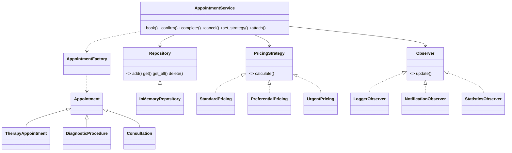

# Лабораторная работа №8 — Паттерны проектирования. Вариант 15 «Медицинская клиника»

* `naive/clinic_naive.py` — наивная реализация (if/elif, хранение внутри сервиса, жёсткие уведомления).
* `project/` — итоговая версия: `python main.py`, тесты — `pytest` (из папки `project`).

| Паттерн | Где | Решаемая проблема |
|---|---|---|
| Repository | `repositories/memory_repository.py` | сервис не знает, где хранятся записи |
| Factory | `factories/appointment_factory.py` | терапевтический приём / диагностическая процедура / консультация создаются в одном месте |
| Strategy | `strategies/pricing.py` | стандартная / льготная / срочная стоимость меняется без правки сервиса |
| Observer | `observers/observers.py` | журнал, уведомление пациента и статистика подписываются на события записи |

| Характеристика | До | После |
|---|---|---|
| Создание объектов | if/elif | Factory |
| Выбор алгоритма | if/elif | Strategy |
| Хранение данных | список внутри сервиса | Repository |
| Уведомления | жёсткие `print` | Observer |

